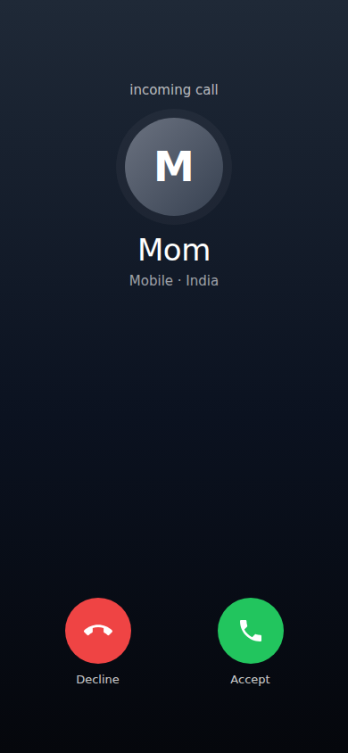

# SafeCircle India

A women's safety web app for India. It shows where registered sexual-violence and harassment cases are highest, checks a route before you travel, and puts SOS, a fake call, a siren and a check-in timer one tap away.

It's a static site (plain HTML, CSS and JavaScript, no build step), so it runs on GitHub Pages for free and installs to a phone's home screen like an app.

<p>
  
  
  
</p>

## Features

**Safety map**
- Risk zones for 13 NCRB metro cities, coloured green / amber / red from NCRB *Crime in India* data
- "Safety signal near you" score that blends the public baseline with your own recent community reports
- Route check: type any place in India, get a real road route, and see which flagged areas it passes through, with distance, ETA and a one-tap **Navigate** link
- Help nearby layer: police stations, hospitals and pharmacies from OpenStreetMap
- Dark, satellite and street base maps (your choice is remembered)

**SOS**
- 3-second countdown (cancel by mistake) or **Send now**
- Live GPS location with accuracy, nearest address and auto-refresh
- One tap to call 112 / 181 / 100, SMS all emergency contacts, or share via WhatsApp
- Messages include a Google Maps link, accuracy, time and battery level
- Nearest police stations with directions, your medical info, and a siren
- Keeps the screen awake while active; "I'm safe" can text your contacts that you're OK

**Safety toolkit**
- **Check-in timer:** if you don't tap "I'm safe" in time, an alarm sounds and SOS opens. Can text your contacts when you set off
- **Fake incoming call:** realistic ringing screen with an optional spoken caller voice, now or after 10 s to 5 min
- **Siren and flash:** loud alarm with screen flashing (kept under 3 flashes a second for photosensitivity)
- **Share my location:** share sheet, WhatsApp or copy
- **Help near me:** list of nearby police, hospitals and pharmacies with call and directions
- **Helplines:** 112, 181, 1091, 100, 108, 1930, NCW, 1098, NALSA 15100, Tele-MANAS 14416
- **Shake to SOS** (opt-in)

**Community reports**
- Anonymous reports with severity, category (stalking, poor lighting, unsafe transport…) and time of day
- Older reports gradually lose influence (ignored after 180 days); verified-account reports count more
- Filter by severity, delete your own reports

**Also**
- Installable app (PWA) that works offline after the first visit: SOS, helplines and the toolkit still open without internet
- Email + phone OTP sign-up (demo mode by default, real codes with Supabase)
- Emergency contacts (up to 5), editable SOS message, medical info card
- Tips for travel, cabs and public transport, online safety, and "know your rights" (Zero FIR and more)
- Download your data as JSON, or erase everything
- Responsive: phone layout with bottom tabs, desktop layout with sidebar
- Accessible: keyboard support, Escape closes dialogs, screen-reader labels, honours reduced-motion

## Run it locally

Any static web server works. Location (GPS) needs `localhost` or `https://`.

```bash
# Python
python3 -m http.server 8000
# or Node
npx serve .
```

Then open http://localhost:8000.

Opening `index.html` directly from disk mostly works, but GPS and offline mode won't.

## Put it on GitHub Pages

1. Push this folder to a GitHub repository.
2. Go to **Settings → Pages**.
3. Under **Build and deployment**, choose **Deploy from a branch**, pick your branch and the `/ (root)` folder, and save.
4. After a minute your app is live at `https://<your-username>.github.io/<repo-name>/`.

GitHub Pages serves over HTTPS, so GPS, install-to-home-screen and offline mode all work there.

## Real verification codes (optional)

Out of the box the app runs in **demo mode**: it shows the verification code on screen instead of sending it. To send real email and SMS codes, connect a free Supabase project. Step-by-step instructions are in [SETUP.md](SETUP.md).

## Project structure

```
index.html            All screens and dialogs
styles.css            One dark theme for mobile and desktop
app.js                State, map, risk scoring, routes, reports, profile, SOS
tools.js              Check-in timer, fake call, siren, help nearby, helplines, shake, install
verify.js             Email + phone OTP sign-up (demo mode or Supabase)
stats.js              Modelled NCRB case counter
config.js             Supabase keys (empty = demo mode)
sw.js                 Service worker: offline app shell
manifest.webmanifest  Install metadata and home-screen shortcuts (SOS, Fake call)
icons/                App icons
vendor/leaflet/       Leaflet 1.9.4 map library (bundled so the app works offline)
```

To add a city, add an entry to `ZONES` in `app.js` with a source for its level. When you change any app file, bump `CACHE` in `sw.js` so installed copies update.

## Privacy

- Your profile, contacts, reports and settings are stored **only in your browser** (`localStorage`). Nothing is sent to a SafeCircle server. There isn't one.
- In Supabase mode, only your email and phone number go to Supabase, for verification.
- Searches, routes and map tiles are fetched from the third-party services listed below. Your location is sent to them only when you search, check a route, look for help nearby or open SOS.

## Third-party services

| Purpose | Service |
| --- | --- |
| Map tiles | CARTO (dark), Esri World Imagery (satellite), OpenStreetMap (street) |
| Place search and address lookup | OpenStreetMap Nominatim |
| Road routing | OSRM public demo server |
| Police, hospitals, pharmacies | OpenStreetMap via Overpass API |
| Fonts | Google Fonts |

The OSRM, Nominatim and Overpass public servers are free but rate-limited and meant for light use. If the app gets real traffic, host your own or switch to a paid provider.

## Data sources and limitations

- Zone levels and the case counter come from NCRB *Crime in India* (2014–2023). These are **registered FIRs**, not all incidents. Higher numbers partly reflect better reporting. Treat the map as awareness, not a verdict on any neighbourhood.
- The counter projects yearly totals forward at their average daily rate. It is an estimate, not a live feed.
- A web app **can't send SMS or call anyone by itself**. SOS opens your phone's dialer, SMS app or WhatsApp with everything filled in, and you press send.
- Phones may pause web apps when the screen locks, so the check-in timer and fake call are most reliable with SafeCircle open on screen.
- Community reports stay on your device. Sharing them between users needs a backend (see ideas below).
- The "Available to help nearby" setting is a preference only until a live responder network exists.

## Ideas for next steps

- Shared community reports and a nearby-responder network (for example, Supabase tables with row-level security)
- Hindi and other Indian languages
- More cities and district-level NCRB data
- Server-sent SMS for SOS and missed check-ins (e.g. Twilio or MSG91, with DLT registration)

## Credits

Map data © OpenStreetMap contributors. Map library: [Leaflet](https://leafletjs.com) (BSD-2-Clause). Crime statistics: National Crime Records Bureau, *Crime in India*.

**In an emergency in India, call 112.**
