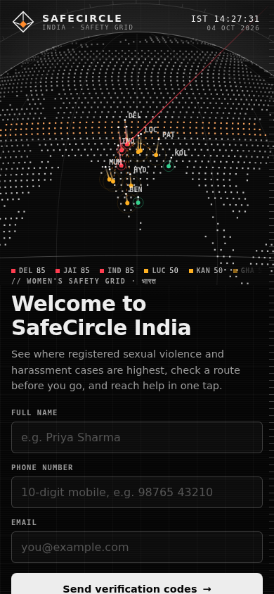
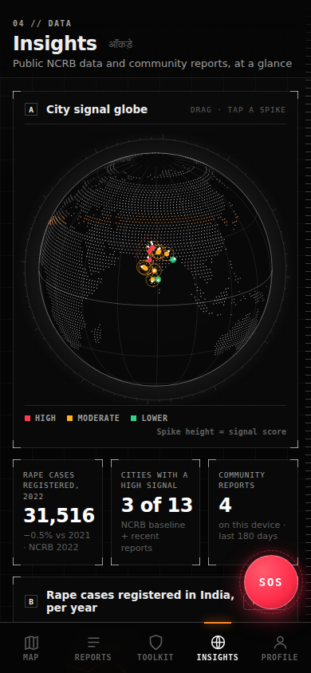
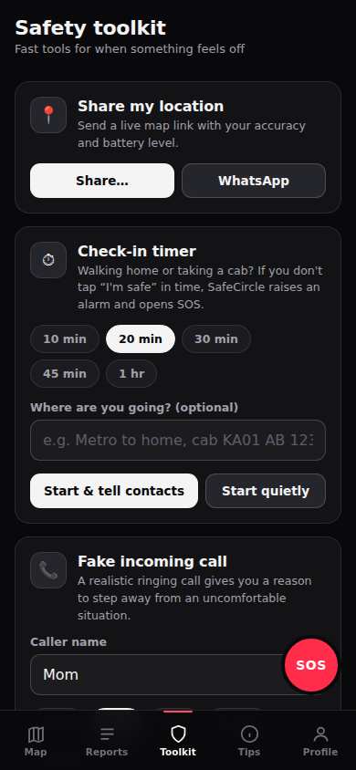
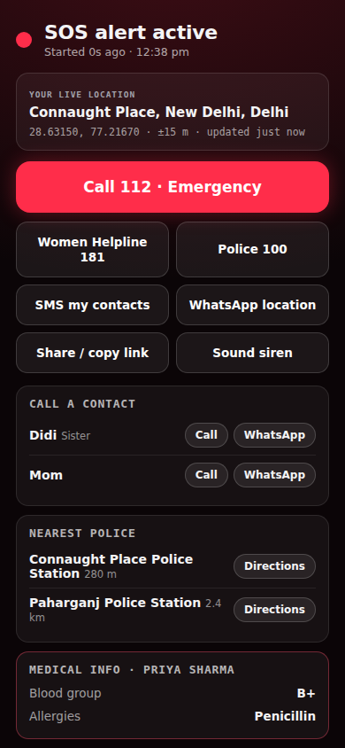
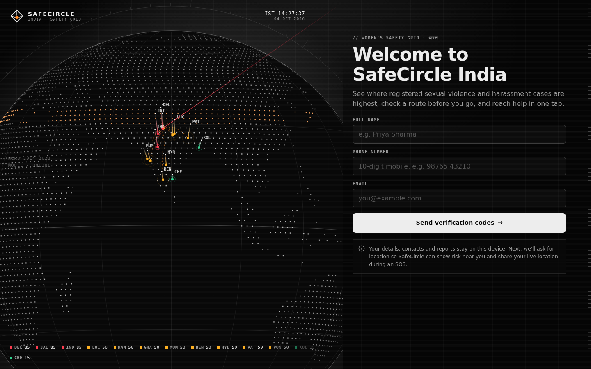

# SafeCircle India

A women's safety web app for India with a sci-fi HUD interface. It shows where registered sexual-violence and harassment cases are highest, checks a route before you travel, and puts SOS, a check-in timer, an evidence recorder, a fake call and a siren one tap away.

It's a static site (plain HTML, CSS and JavaScript, no build step), so it runs free on GitHub Pages and installs to a phone's home screen like an app. Outside services (APIs) plug in from one file, `config.js`.

<p>
  
  
  
  
</p>
<p></p>

## Features

**Interface**
- Monochrome HUD design: hairlines, corner brackets, mono data labels, scan lines and a live clock
- Animated dotted globe, built from Natural Earth land data, centred on India with signal spikes for each city
- Monochrome map (dark, satellite or street) with reticle markers, a centre crosshair, a live coordinate readout and a radar ping when you locate yourself
- Mobile layout with bottom tabs; desktop layout with a sidebar

**Insights** (new tab)
- Interactive globe: drag to spin, tap a city spike to open it
- Stat tiles, NCRB trend chart 2014–2022 with hover and keyboard crosshair, city signal ranking, report heatmap by day and time, and report categories
- Every chart has a table view

**Safety map**
- Risk zones for 13 NCRB metro cities, from NCRB *Crime in India* data
- "Safety signal near you" score, blending the public baseline with community reports (reports can only raise a score)
- Route check: search any place in India, get a road route, see the flagged areas on it, then **Navigate** or **Share trip**
- Help nearby layer: police stations, hospitals and pharmacies from OpenStreetMap

**SOS**
- 3-second countdown (or **Send now**), live GPS with address, accuracy and auto-refresh
- One tap to call 112 / 181 / 100, SMS all contacts, or share on WhatsApp
- Nearest police with directions, medical info, siren, and audio evidence recording
- With an alert server connected (see [API.md](API.md)), your contacts get the alert automatically, with live location updates

**Safety toolkit**
- **Check-in timer:** an alarm and SOS if you don't confirm you're safe in time. With an alert server, it still alerts your contacts if the phone dies or is locked.
- **Evidence recorder:** records audio with a live waveform, saved on the device with time and place; download or delete
- **Fake incoming call** with an optional spoken caller voice
- **Siren and flash** (kept under 3 flashes a second)
- **Share my location**, **Help near me**, **India helplines** (112, 181, 1091, 1930, NCW and more), **Safety guide**
- **Shake to SOS** (opt-in)

**Also**
- Community reports with severity, category and time of day; they fade with age and can be shared between users
- Installable app that works offline after the first visit
- Email + phone OTP sign-up (demo mode by default, real codes with Supabase)
- Emergency contacts, custom SOS message, medical info card, data export, erase everything
- Accessibility: keyboard support, Escape closes dialogs, screen-reader labels, honours reduced-motion

## Open it in VS Code

1. Unzip the project, then in VS Code choose **File → Open Folder…** and pick the `safecircle-india` folder.
2. When VS Code suggests the recommended extensions, install **Live Server** (or search for it in the Extensions panel).
3. Click **Go Live** in the bottom-right status bar, or right-click `index.html` → **Open with Live Server**. The app opens at http://127.0.0.1:5500.
4. Edit any file and save. The page reloads by itself.

Tips:
- Sign-up runs in demo mode, so the verification code is shown on screen.
- Press **F5** (with Live Server running) to open the app in Chrome with the debugger attached. Pick "phone size" to see the mobile layout.
- On your own computer the offline cache is switched off, so you always see your latest code. Add `?sw=on` to the address to test offline mode.
- In Chrome, press **Ctrl+Shift+M** (**Cmd+Shift+M** on Mac) in DevTools to preview phone sizes.

## Run it without VS Code

Any static web server works. GPS and the microphone need `localhost` or `https://`.

```bash
python3 -m http.server 8000      # or: npx serve .
```

Open http://localhost:8000.

## Put it on GitHub Pages

1. Push this folder to a GitHub repository.
2. Go to **Settings → Pages → Build and deployment**, choose **Deploy from a branch**, then your branch and `/ (root)`.
3. A minute later it's live at `https://<your-username>.github.io/<repo-name>/`, over HTTPS, so GPS, install and offline mode all work.

## Connecting APIs

Everything optional is switched on in **`config.js`**. Step-by-step instructions are in **[API.md](API.md)**:

| Connection | What it adds | Guide |
| --- | --- | --- |
| Supabase auth | Real email and SMS verification codes | [SETUP.md](SETUP.md) |
| Shared reports | Everyone's reports on everyone's map (Supabase table + SQL included) | API.md §2 |
| Alert server | Automatic Telegram/SMS alerts for SOS and missed check-ins (ready-to-deploy Cloudflare Worker included) | API.md §3 |
| Your zone data | Load cities and risk levels from your own JSON API | API.md §4 |
| Anything else | The pattern for adding any API, and keeping secret keys off the browser | API.md §5 |

**Profile → Connections** shows which ones are on.

## Project structure

```
index.html            All screens and dialogs
styles.css            HUD theme (mobile + desktop)
config.js             Your API settings (empty = demo mode)
api.js                All outside-service connections: Supabase, shared reports, webhook, zones
app.js                State, map, risk scoring, routes, reports, profile, SOS
tools.js              Check-in timer, fake call, siren, help nearby, helplines, shake, install
recorder.js           Evidence recorder (MediaRecorder + IndexedDB)
globe.js              Dotted canvas globe (no libraries)
globe-data.js         Land dots for the globe (from Natural Earth)
insights.js           Sign-in hero and the Insights screen charts
verify.js             Email + phone OTP sign-up
stats.js              Modelled NCRB case counter
sw.js                 Service worker: offline app shell (off on localhost unless ?sw=on)
manifest.webmanifest  Install metadata and home-screen shortcuts (SOS, Fake call)
api-examples/         Alert server (Cloudflare Worker), Supabase SQL, example zones JSON
vendor/leaflet/       Leaflet 1.9.4 map library (bundled for offline use)
.vscode/              Recommended extensions, Live Server settings, Chrome launch config
```

When you change any app file, bump `CACHE` in `sw.js` so installed copies update.

## Privacy

- Profile, contacts, reports, settings and recordings are stored **only in your browser**, unless you switch on shared reports or an alert server.
- With shared reports, your reports (not your name) go to your Supabase project. With an alert server, SOS and check-in events, including location and contacts, go to the server you configure.
- Searches, routes and map tiles go to the third-party services below, and only when you use them.

## Third-party services

| Purpose | Service |
| --- | --- |
| Map tiles | CARTO (dark), Esri World Imagery (satellite), OpenStreetMap (street) |
| Place search and address lookup | OpenStreetMap Nominatim |
| Road routing | OSRM public demo server |
| Police, hospitals, pharmacies | OpenStreetMap via Overpass API |
| Fonts | Google Fonts |

The OSRM, Nominatim and Overpass public servers are free but rate-limited. For real traffic, see API.md §1.

## Data sources and limitations

- Zone levels, charts and the counter come from NCRB *Crime in India* (2014–2023). These are **registered FIRs**, not all incidents; higher numbers partly reflect better reporting. Treat the map as awareness, not a verdict on any neighbourhood.
- The counter projects yearly totals forward at their average daily rate. It is an estimate, not a live feed.
- Without an alert server, the app can't send SMS by itself. SOS opens your SMS app or WhatsApp with everything filled in, and you press send.
- Phones may pause web apps when locked. The alert server's check-in timer covers this case.

## Credits

Map data © OpenStreetMap contributors. Land outlines: Natural Earth (public domain) via world-atlas. Map library: [Leaflet](https://leafletjs.com) (BSD-2-Clause). Crime statistics: National Crime Records Bureau, *Crime in India*.

**In an emergency in India, call 112.**
